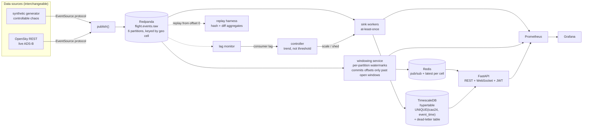
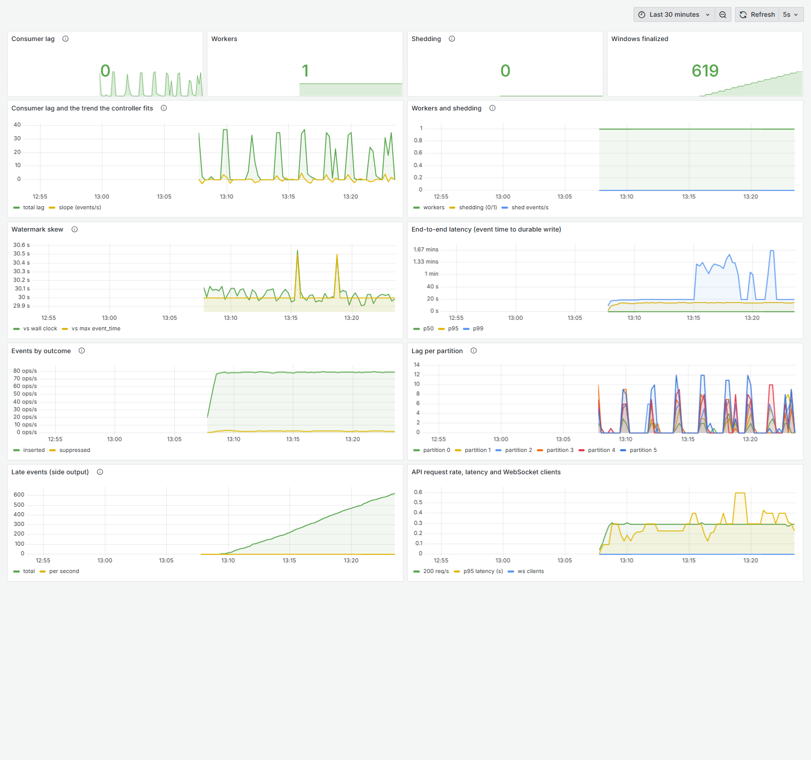

# Contrail

An event-time stream processor for flight telemetry: ADS-B state vectors flow through Redpanda into
windowed aggregates, with a lag-driven control loop that scales and sheds under load, and a replay
harness that proves the whole thing is deterministic.

Built to demonstrate three specific claims, each measured rather than asserted. Every number below
came from a run on the machine described in [BENCHMARKS.md](BENCHMARKS.md), and every one is
reproducible with a command printed beside it there.

---

## The three claims

### 1. Event-time windowing with watermarks beats a processing-time baseline

Both processors run over the *identical* event stream and are scored against ground truth computed
from that same stream. At an allowed-lateness bound equal to the maximum arrival skew:

| disorder | events misplaced, naive | events misplaced, watermark |
|---|---|---|
| low (5s skew) | 0.18% | **0.00%** |
| medium (20s skew) | 3.06% | **0.00%** |
| high (45s skew) | 13.66% | **0.00%** |

**12,049 of 88,199 events filed into the wrong window by the baseline; zero by the watermark
engine** — exactly correct, not within tolerance. Worst single window off by 18 aircraft.

The property behind it is testable as an equality: `allowed_lateness >= max arrival skew` implies the
output is *identical* to ground truth, and error appears only as the bound tightens below the skew.
Events that miss their window even so are not dropped; they go to a counted, logged side output.
Under the harshest configuration that is 15,945 unreported misfilings by the baseline against **0**.

*Evidence:* `python -m scripts.benchmark_windowing`, [BENCHMARKS.md](BENCHMARKS.md#claim-1--event-time-windowing-vs-a-processing-time-baseline). Single run on the machine in BENCHMARKS.md, recorded before commit SHAs and image digests were captured; the benchmark now repeats runs and saves them (see "Method and what is saved").

### 2. A lag-trend controller keeps up where a static pool does not

Same 6x burst run twice — once with the pool pinned, once adaptive. Both arms run the controller and
the same lag sampler; only one applies its decisions, so the gap is adaptation, not instrumentation.

| | static (1 worker) | adaptive (1-4) |
|---|---|---|
| events absorbed | 75.9% | **100%** |
| peak lag | 33,480 | **10,780** |
| final lag | **14,660 — never recovered** | **0** |
| p95 latency | 112.80s | **17.71s** |
| p99 latency | 115.50s | **21.96s** |

The headline is not the ratio: it is that the static arm **never recovers**. A minute after the burst
it was still 14,660 events behind with a quarter of the load unprocessed.

The controller acts on the *trend* in lag, not a threshold, and requires that trend to be
statistically distinguishable from noise before acting — an earlier version scaled up three times and
shed on a flat, noisy lag series. See [DESIGN_DECISIONS.md](DESIGN_DECISIONS.md) §1.4.

*Evidence:* `python -m scripts.benchmark_control`, [BENCHMARKS.md](BENCHMARKS.md#claim-2--adaptive-lag-control-vs-a-static-worker-pool). Single run on the machine in BENCHMARKS.md, recorded before commit SHAs and image digests were captured; the benchmark now repeats runs and saves them (see "Method and what is saved"). The static arm is pinned at one worker, not the strongest fixed pool.

### 3. Replay is deterministic, including across a crash

| check | result |
|---|---|
| 3 replays of one 9,321-message recording | **identical SHA-256 digest** |
| replay `SIGKILL`ed mid-stream, restarted | **digest matches the uninterrupted run** |
| same events over 1 Kafka partition vs 6 | **identical digest** |
| repeated 3x | no flakes |

A replay is a pure function of the recorded topic, so a crash costs progress and nothing else — there
is no partial state to reconcile. Paired with the sink's database-enforced idempotency (a `SIGKILL`ed
consumer restarts and lands on the exact unique row count, zero duplicates), the pipeline is
crash-safe at both ends: **writes are idempotent, reads are reproducible.**

*Evidence:* `pytest tests/integration/test_replay_determinism.py` and the sink SIGKILL test in `tests/integration/test_sink_idempotency.py`, [BENCHMARKS.md](BENCHMARKS.md#claim-3--deterministic-replay). This is about replay and the sink; it says nothing about live window-state recovery, which the table below keeps separate.

---

## Guarantees and non-guarantees

| property | status | what backs it |
|---|---|---|
| sink writes are idempotent (no duplicate rows after a crash or replay) | **yes** | database unique key; SIGKILL integration test |
| window output is exact when `allowed_lateness >= max arrival skew` | **yes** | claim 1; unit tests assert the equality |
| replay of a sealed recording is deterministic | **yes** | claim 3; an incomplete or empty recording now fails instead of hashing a suffix |
| delivery to Redis | **at-least-once**, not exactly-once | offsets commit after publish; a stale window never overwrites a larger one |
| live crash recovery of window state | **yes, in the tested scenario** | offsets commit only up to the oldest open window; `test_windowing_recovery.py` kills the service (SIGKILL and SIGTERM) mid-stream, restarts it, and checks every window against ground truth. It fails if offsets are committed naively (31 of 60 events counted) or if the restart does not wait for its backlog partitions |
| a silent partition does not stall windows | **opt-in** (`IDLE_TIMEOUT_S`), off by default | unit tests; with it off, one idle partition stalls finalization |
| duplicate suppression | within a rolling event-time horizon only | past it a repeat is counted late, never double counted |
| behaviour under overload | bounded lag by **deliberately dropping events** (claim 2b) | one overload point, one run |
| WebSocket delivery | **best-effort**; reconcile via the snapshot or `GET /api/windows` | by design of Redis pub/sub |
| poison records in the sink | quarantined to a dead-letter table, the rest of the batch lands, replays do not duplicate them | integration test with an unparseable and a contract-violating record |
| security | login throttling, strict config checks, non-root images | **no** TLS, per-user accounts, or rate limits shared across replicas |

Operating notes, configuration reference and per-service recovery behaviour are in
[docs/OPERATIONS.md](docs/OPERATIONS.md).

---

## Architecture



Redis is the seam between the pipeline and the API: the API never joins the Kafka consumer group, so
scaling it cannot steal partitions from the pipeline.



---

## Local demo

```bash
docker compose up -d          # everything, including a live self-demonstrating pipeline
```

This is a **demo configuration**: default credentials, an anonymous Grafana, no TLS. Its ports for the broker, databases, Prometheus and Grafana bind to loopback; the API listens on all interfaces. Do not expose it as is; see [Production deployment](#production-deployment).

That brings up Redpanda, TimescaleDB, Redis, the API, the windowing service, the adaptive pipeline,
a synthetic generator, Prometheus and Grafana.

| what | where |
|---|---|
| Grafana dashboard | http://localhost:3000 (anonymous viewer, loopback only) |
| Prometheus | http://localhost:9090 |
| API health | http://localhost:8000/healthz |
| API docs | http://localhost:8000/docs |

```bash
# get a token, read the current window aggregates
TOKEN=$(curl -s -X POST localhost:8000/auth/login -H 'Content-Type: application/json' \
  -d '{"username":"operator","password":"contrail"}' | jq -r .access_token)
curl -s localhost:8000/api/windows -H "Authorization: Bearer $TOKEN" | jq

# switch to the live OpenSky feed -- no code change
SOURCE=opensky docker compose up -d generator
```

### WebSocket delivery is best-effort

`/ws/windows?token=<jwt>` streams finalized windows from Redis pub/sub, which keeps nothing for a
client that is not connected. A client that was away, too slow, or past its token's expiry has missed
messages. Right after subscribing it receives `{"type": "snapshot", "windows": [...]}` (the latest
window per cell, same as `GET /api/windows`), then `window` messages and idle `heartbeat`s. After any
reconnect treat the snapshot, or `GET /api/windows`, as the truth and key live messages on
`(window_start, partition_key)`. The server closes with 1008 when the token expires and 1011 when
Redis fails or the client cannot keep up (5 s send timeout); reconnect with a fresh token.

### Reproducing the claims

```bash
docker compose run --rm --no-deps tests python -m scripts.benchmark_windowing   # claim 1
docker compose run --rm --no-deps api   python -m scripts.benchmark_control     # claim 2
docker compose run --rm tests pytest -q tests/integration/test_replay_determinism.py  # claim 3
BURST_RATE=12 bash scripts/chaos_kill.sh 45                                     # chaos test
docker compose run --rm tests pytest -q                                         # full suite
```

## Production deployment

The gap between the demo and a real deployment is configuration, and none of it needs reading the
source. The short version, with the full table and every variable in
[docs/OPERATIONS.md](docs/OPERATIONS.md):

- Set `APP_ENV=production`. The API then **refuses to start** on the default `API_PASSWORD`, the
  placeholder `JWT_SECRET`, or a secret shorter than 32 characters.
- Keep the broker, database and dashboard ports on loopback (`BIND_HOST`), terminate TLS in front of
  the API, and set `TRUSTED_PROXY_HOPS` to the number of proxies so rate limits see real client addresses.
- Set `IDLE_TIMEOUT_S` if a partition can go quiet, and `RETENTION_DAYS` so the events table is bounded.
- `docker compose down -v` deletes the database volume.

Not provided: TLS, per-user accounts, rate limits shared between API replicas, high availability for
Redpanda, TimescaleDB or Redis.

---

## What this is and is not

**The synthetic generator is the primary source, and that is a choice, not a shortcut.** Every
benchmark above runs against it, because its disorder is *controllable* — out-of-order probability, arrival skew,
duplicate rate, late-arrival delay and drop rate are all configuration, so a claim like "exactly
correct when the lateness bound covers the skew" can be stated as an equality and tested. You cannot
do that against a live feed, because you cannot ask the real world for 45 seconds of skew on demand.

**The OpenSky adapter is real and optional.** It ran for 5.5 minutes during development and stored
22,702 rows from 1,166 genuine aircraft; it implements the same `EventSource` protocol, so nothing
downstream knows which source is running. It is the reality check, not the measurement instrument.

Known limitations, all documented in full in [DESIGN_DECISIONS.md](DESIGN_DECISIONS.md):

- **Windowing crash recovery is tested in one scenario, not in general.** The service used to
  auto-commit offsets, so a crash lost every window that had not finalized. It now commits only up to
  the oldest record still in an open window, republishes idempotently (a stale or smaller window never
  overwrites a larger one), and on restart waits for every partition that has a backlog before the
  watermark moves (otherwise the partition that replays first closes windows the others still
  belong to; the test caught exactly that). The integration test kills the service once, at one point
  in one synthetic stream, and checks every window; that is evidence, not a proof. Delivery to Redis
  is at-least-once, never exactly-once, and the late-event total can double count replayed records
  after a recovery.
- **The latest-per-cell hash in Redis only moves forward in event time.** That is what makes a replay
  harmless, and it also means data whose event time is older than what a cell already holds (a
  recording replayed through the live service, a clock that steps back) is silently not published for
  that cell until the key is cleared.
- **Idle partitions stall the watermark unless `IDLE_TIMEOUT_S` is set.** The global watermark is the
  minimum across partitions, so a partition that stops delivering halts finalization. The timeout
  that drops it out of the minimum is opt-in and off by default, because it reads the wall clock and
  claim 3's determinism depends on that processor being clock-free (replay never sets it). A partition
  that has never delivered an event is not tracked even when it is set.
- **Live data concentrates in four geographic cells** under the default bounding box, so partition
  balance measured on worldwide synthetic traffic does not transfer to a regional live feed.
- **Load shedding is measured separately, at a two-worker cap** (claim 2b in BENCHMARKS.md), because
  the four workers in claim 2 absorb that burst outright and never reach the ceiling. What claim 2b
  shows is bounded degradation under an overload scaling cannot fix: lag held flat at ~8,100 instead
  of climbing, at the cost of 14,668 deliberately dropped events. What it does not show is shedding
  at any other fraction or overload ratio — 0.25 of cells against a 220 ev/s deficit is one point on
  a curve, not a characterisation.
- **Under a sustained 6x burst the pipeline stabilises lag rather than clearing it.** Bounded, not
  unbounded, which is the design intent — but it is not "full recovery under sustained overload".
- The API load-test figures at 100 users are CPU-bound on a two-core laptop running the entire stack
  plus the load generator; the 20-user column is the honest latency measure.

## Layout

```
src/ingestor/    synthetic + OpenSky sources, publisher, idempotent sink
src/windowing/   naive baseline, watermark engine, live service, shared aggregates
src/control/     lag monitor, trend controller, worker supervisor
src/replay/      determinism harness
src/api/         FastAPI, JWT, token-bucket rate limiting
scripts/         the three benchmarks, the chaos test, the Phase 0 report
ops/             Prometheus config, Grafana provisioning + dashboard JSON
```

- [DESIGN_DECISIONS.md](DESIGN_DECISIONS.md) — every non-obvious choice, the alternative considered,
  and why it lost. Including the ones that were wrong first.
- [docs/OPERATIONS.md](docs/OPERATIONS.md) — production checklist, configuration reference, delivery
  semantics and per-service recovery behaviour.
- [BENCHMARKS.md](BENCHMARKS.md) — every number above, with the exact configuration and machine that
  produced it.
